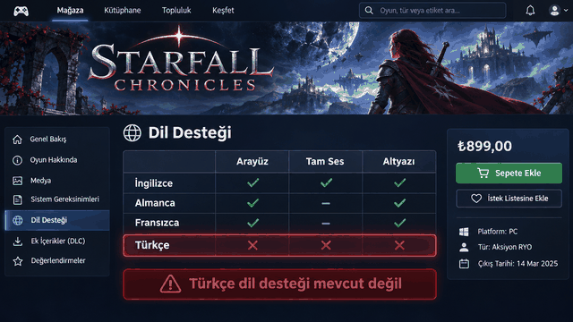

# Transcreen

**Live on-screen translator for Windows.** Transcreen watches the screen and paints the Turkish
translation of every piece of foreign text **right on top of it**: same position, same size, same
colors. Think Google Lens, but live and system-wide.

<p align="center">
  
  <br>
  <sub>Teaser animation, made with AI. In the app itself, the translation is drawn in the style of the original text.</sub>
</p>

<p align="center">
  <a href="../../releases/latest/download/Transcreen-windows.zip"><b>⬇ Download for Windows</b></a>
  &nbsp;·&nbsp;
  <a href="README.tr.md">Türkçe README</a>
</p>

There is no window and no buttons. Start it, and foreign text on screen turns Turkish in place.
The overlay is click-through, so you keep using whatever is underneath it. It works in games,
videos, browsers, and desktop apps alike.

## Features

- **Live, whole-screen translation.** An unchanged screen costs one cheap capture per cycle. When
  something changes, only the changed region is read again.
- **Matches the original text.** Transcreen keeps the source text's position, size, weight (it
  detects bold) and colors, and it also handles rotated text up to about ±30°.
- **Translates sentences, not fragments.** Lines are grouped into paragraph blocks and translated
  together, then word-wrapped back into the original box. Game subtitles split by wide word
  spacing are re-joined first.
- **Optional offline first paint.** A local CTranslate2 model (Opus-MT en→tr) translates new text
  in about 0.1 s without internet. The cloud translation replaces it silently when it arrives.
- **Built for games and video.** It damps OCR jitter on animated backgrounds and has a subtitle
  mode. HUD counters ("200 / 200") and icon noise are filtered out, and selecting text does not
  wipe the translation.
- **Stays out of the way.**
  - The overlay is excluded from screen capture, so the app never reads its own output.
  - It is unmapped whenever there is nothing to draw.
  - It stands down while a DRM-protected window (Netflix and similar) has focus.
- **Persistent cache.** Text the app has already translated appears instantly, even after a
  restart.

## Requirements

- Windows 10 (version 2004 or later) or Windows 11
- Python 3.11+ and [uv](https://docs.astral.sh/uv/)
- At least one Windows OCR language pack. English is recommended. Windows usually installs the
  pack for its display language; to add another, open **Settings → Time & Language → Language &
  region**.
- An internet connection for cloud translation. It is optional once the offline model is
  installed.

## Quick start

1. Download **`Transcreen-windows.zip`** from the [latest release](../../releases/latest) and
   extract it, or clone this repository.
2. Double-click **`Transcreen.bat`**. If Windows shows a security prompt for a downloaded file,
   choose **Run**. The first run sets up everything that is missing, which
   takes a few minutes once:
   - [uv](https://docs.astral.sh/uv/), through its official installer;
   - the Python dependencies;
   - the offline translation model (opus-mt-tc-big en→tr, about 476 MB).

   Later runs only re-check and start right away without a console. A short toast lists the
   shortcuts.

If the model download fails, Transcreen opens with cloud translation and the launcher tries again
on the next start. To skip the offline model entirely, set `"use_local_mt": false` in
`%APPDATA%\Transcreen\config.json` before the first start.

On a weak machine you can install the lighter Argos model instead (about 125 MB, noticeably lower
quality). Run this in PowerShell from the project folder before the first start:

```powershell
$env:UV_PROJECT_ENVIRONMENT = "$env:LOCALAPPDATA\uv-envs\transcreen"
$env:PYTHONPATH = "src"
uv run python -m transcreen --setup-local --small-model
```

| Shortcut     | Action |
| ------------ | ------ |
| `Ctrl+Alt+T` | Pause / resume (the overlay hides) |
| `Ctrl+Alt+S` | Screenshot mode: for 8 s, translations show up in your own screenshots too |
| `Ctrl+Alt+Q` | Quit |

To start the app manually from PowerShell, run this from the project folder:

```powershell
$env:UV_PROJECT_ENVIRONMENT = "$env:LOCALAPPDATA\uv-envs\transcreen"
$env:PYTHONPATH = "src"
uv run python -m transcreen
```

## Portable single-file build

`tools/build_onefile.py` packs the whole app into one Python file:

```powershell
uv run python tools/build_onefile.py    # writes dist/Transcreen.py
```

Copy `Transcreen.py` to any folder or any Windows PC and double-click it, or run
`python Transcreen.py`. The target PC only needs Python 3.10–3.13 from python.org. On the first
run, the file installs its packages once into `%LOCALAPPDATA%\Transcreen` (this takes 1–3 minutes
and needs internet), then restarts itself from there. The flags `--selftest`, `--setup-local` and
`--smoke` work the same way.

## Configuration

There is no settings UI. Edit `%APPDATA%\Transcreen\config.json` by hand:

```json
{
  "target_lang": "tr",
  "ocr_lang": "auto",
  "idle_poll": 0.012,
  "min_text_height": 10,
  "use_local_mt": true
}
```

| Key | Meaning |
| --- | --- |
| `target_lang` | Target language as a Google language code. The app is built for Turkish: the offline model, the "already Turkish" detection and the UI messages assume `tr`. |
| `ocr_lang` | `auto` (prefers English when that pack is installed) or a tag such as `en-US`. |
| `idle_poll` | Pause between checks of an unchanged screen, in seconds. A lower value reacts faster but uses more CPU. |
| `min_text_height` | Lines shorter than this many pixels are treated as noise. |
| `use_local_mt` | Use the offline model for the first paint when it is installed. `false` also stops the launcher from downloading it. |

## Privacy

- **Local steps.** Screen capture and OCR run on your PC. Transcreen uses the built-in Windows OCR
  engine and never uploads screenshots.
- **Cloud translation.** Only the recognized text lines that need translating are sent:
  - to Google Translate, through the public but undocumented `translate.googleapis.com` endpoint
    that browser extensions also use;
  - to [MyMemory](https://mymemory.translated.net/) as a fallback while Google is rate limiting.

  Pause with `Ctrl+Alt+T` while sensitive content is on screen.
- **Local files.** Translations are cached in `%APPDATA%\Transcreen\cache.json` and a log is
  written to `%APPDATA%\Transcreen\app.log`. Delete that folder to wipe everything.
- **No tracking.** There is no telemetry, no account and no API key.

## How it works

```
screen  →  vision  →  ocr  →  translator  →  overlay
 (mss)    (change      (Windows   (cache, local     (click-through,
          detection,    OCR,       model, cloud,     capture-excluded
          typography)   bands)     background)       canvas)
                   app: the live loop, stabilization, shortcuts
```

1. **Capture.** The screen is captured with `mss` (about 15–21 ms) and reduced to a tiny grayscale
   signature. On an unchanged screen this is the whole cost of a cycle, and OCR does not run.
2. **Change detection.** The signature is split into 16×9 tiles, and only the dirty region is
   OCR'd. Large regions are cut into horizontal bands and read on four OCR engines in parallel.
   A 140 px strip takes about 55 ms and a full frame about 63 ms.
3. **Motion handling.** While the screen moves (scrolling, transitions), OCR waits up to 0.25 s
   so blurred frames are not read. During continuous motion such as video, every pass reads the
   live frame.
4. **Stabilization.** Animated backgrounds make OCR flicker. Readings are voted across frames:
   - a new line must be seen twice before it is drawn;
   - a garbled re-read cannot replace a clean line;
   - lines whose pixels go blank disappear immediately.
5. **Translation.** It runs on a background thread. The translator works in this order:
   1. It serves cached lines instantly.
   2. It paints misses from the offline model when that model is installed.
   3. It fetches the cloud translation (Google over a keep-alive session, about 100–300 ms) to
      upgrade the result. If Google starts rate limiting, the app switches to MyMemory for a
      cooldown period. Results where a fallback service only echoed the source text are never
      cached.
6. **Rendering.** The font size comes from the measured ink height of the source glyphs. Cover
   and text colors are sampled from the source pixels, and all covers are drawn before any text
   so overlapping blocks never hide each other.

Typical latency: a local change appears in about 0.08–0.1 s, a full-screen change in about
0.1–0.15 s, and text seen for the first time needs another 0.1–0.3 s for translation. Subtitles in
video turn Turkish within about 0.1–0.3 s.

## Troubleshooting

- **The toast says "Çeviri alınamadı".** Transcreen has no internet connection. It recovers by
  itself once the connection is back.
- **The toast says "Windows OCR dil paketi yok".** No OCR language pack is installed. Add a
  language under Settings → Time & Language → Language & region.
- **A shortcut does not work.** Another app may own that shortcut, and a toast warns you when this
  happens. To quit without the shortcut, end `pythonw` in Task Manager.
- **Known limits:**
  - DRM-protected windows appear black in captures.
  - Very short-lived text, such as fast-scrolling credits, can be missed.
  - Windows OCR sometimes skips tiny tokens such as "x2".
  - The offline model's quality is below the cloud's.

## Development

```powershell
$env:UV_PROJECT_ENVIRONMENT = "$env:LOCALAPPDATA\uv-envs\transcreen"   # keeps the venv out of synced folders
uv sync
uv run pytest
uv run ruff check src tests tools ; uv run ruff format src tests tools
uv run mypy src
$env:PYTHONPATH = "src"; uv run python -m transcreen --selftest   # OCR + translation + timing report
$env:PYTHONPATH = "src"; uv run python -m transcreen --smoke out  # overlay screenshot into ./out
uv run python tools/subtitle_bench.py full                         # video-subtitle latency bench
```

**Why `PYTHONPATH=src` and `tool.uv.package = false`?** On Python 3.11, `.pth` files are decoded
with the ANSI code page, so an editable install breaks when the project path contains non-ASCII
characters. The app therefore always runs straight from `src/`.

Project layout: `src/transcreen/` holds the app modules, `tests/` the pytest suite (the Windows OCR
tests skip themselves when no engine is available), and `tools/` the single-file builder and the
subtitle benchmark.

## Credits

- [Opus-MT tc-big en→tr](https://huggingface.co/Helsinki-NLP/opus-mt-tc-big-en-tr) by
  Helsinki-NLP (CC BY 4.0). Transcreen uses the CTranslate2 conversion
  [`ooeoeo/opus-mt-tc-big-en-tr-ct2-float16`](https://huggingface.co/ooeoeo/opus-mt-tc-big-en-tr-ct2-float16).
- The [Argos Translate](https://github.com/argosopentech/argos-translate) en→tr package is the
  `--small-model` option.
- Libraries: [Pillow](https://python-pillow.org/), [mss](https://github.com/BoboTiG/python-mss),
  [winsdk](https://github.com/pywinrt/python-winsdk),
  [deep-translator](https://github.com/nidhaloff/deep-translator),
  [CTranslate2](https://github.com/OpenNMT/CTranslate2),
  [SentencePiece](https://github.com/google/sentencepiece).

The translation models are downloaded at setup time and are not part of this repository.
Transcreen is not affiliated with Google or MyMemory. The Google endpoint it uses is undocumented
and may change or be rate limited at any time, so please use it responsibly.

## License

[MIT](LICENSE)
